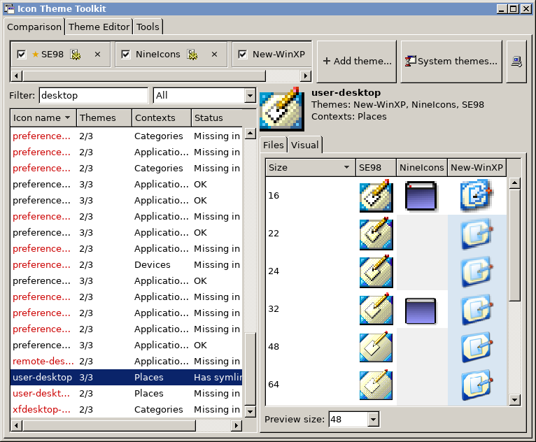
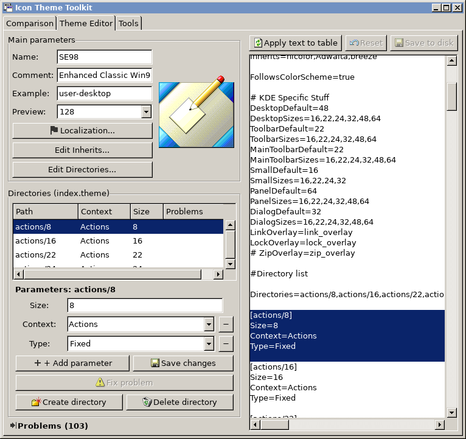
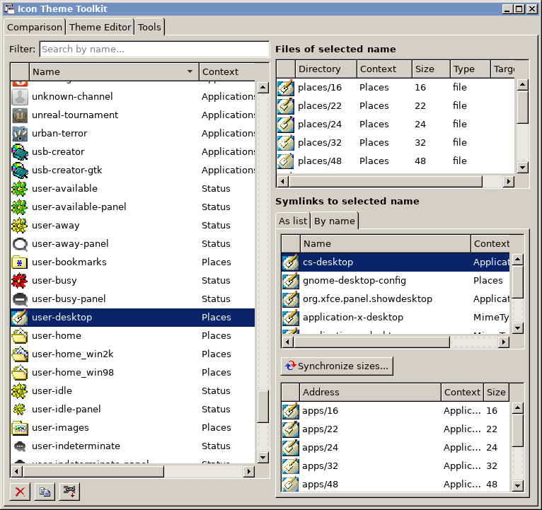
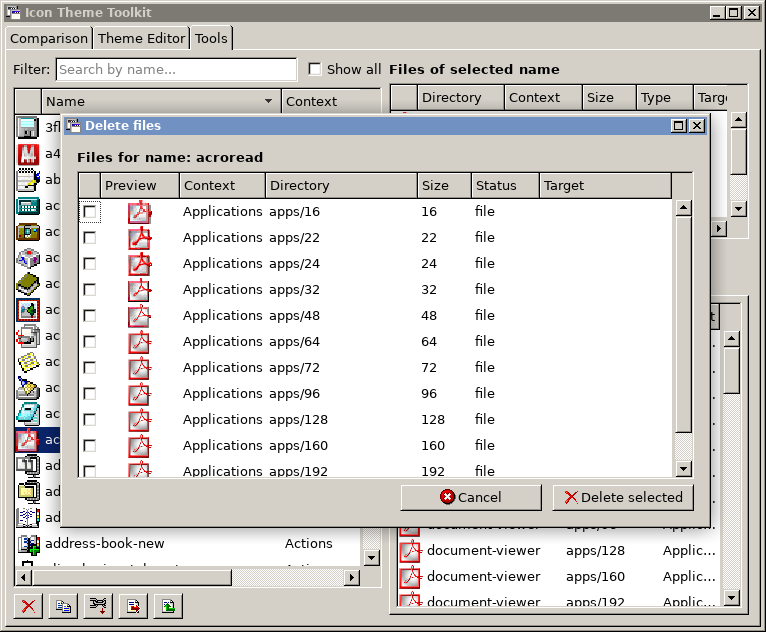
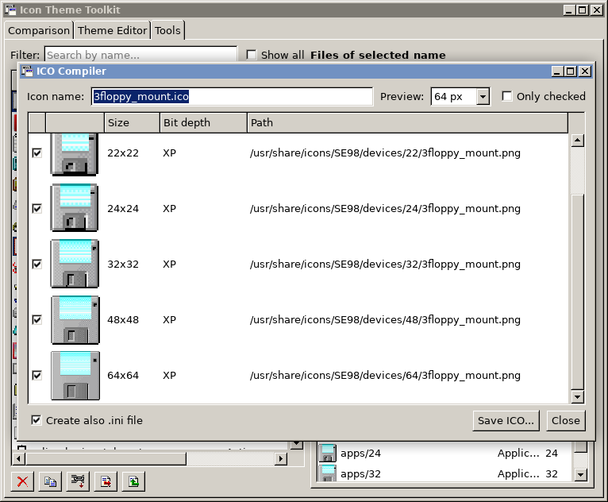
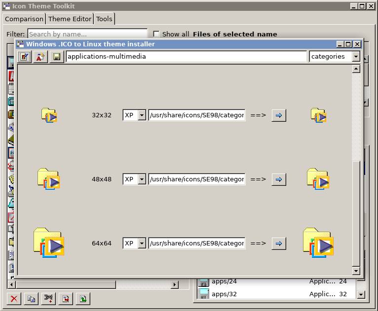
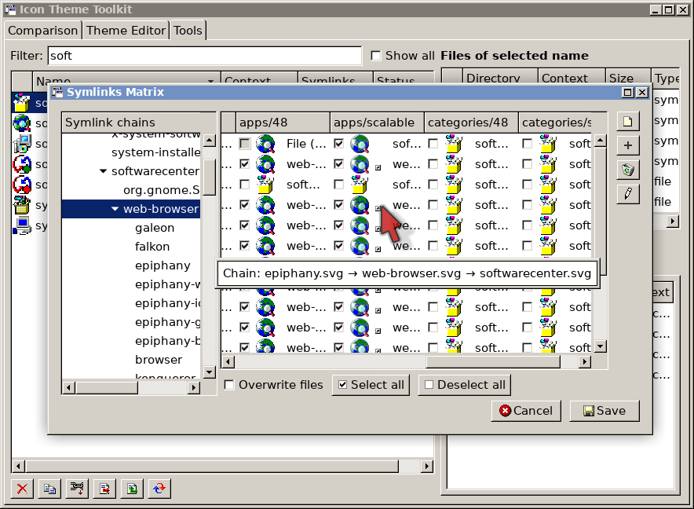
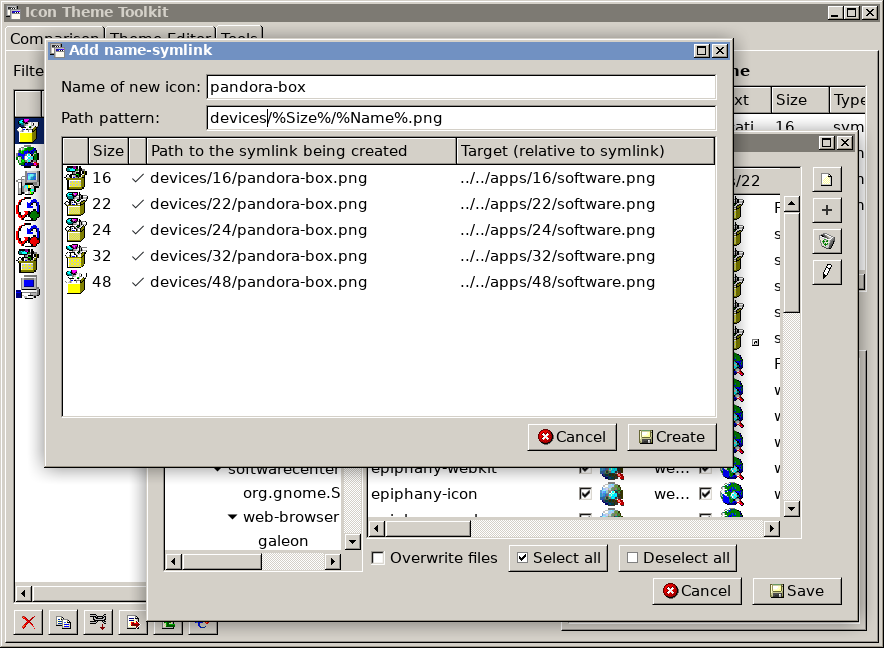
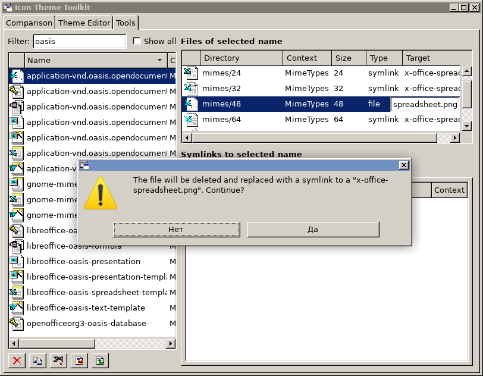

# Icon Theme Toolkit (English beta)

## Description:
English version of [icon-theme-toolkit](https://github.com/nestoris/icon-theme-toolkit-rus) for international beta-testers.

The translation is performed by [this script](https://github.com/nestoris/icon-theme-toolkit-rus/blob/main/translate.awk), and it might have missed something.

## How to use:
```
git clone https://github.com/nestoris/icon-theme-toolkit.git
cd icon-theme-toolkit
gjs icon-theme-toolkit.js [icon_theme_dir]
```
### Or:
```
git clone https://github.com/nestoris/icon-theme-toolkit.git
cd icon-theme-toolkit
sudo make install
icon-theme-toolkit [icon_theme_dir]
```

## Requirements:
`GJS, GTK3, gdk-pixbuf2, icoutils (optional - for ICO import/export)`
## Screenshots:
Icon themes comparison tab:



index.theme editing tab:



Theme tools overal:



Selective removing tool:



ICO export tool:



ICO import tool:



Symlink matrix tool:





In-table symlink editing/creaing:



