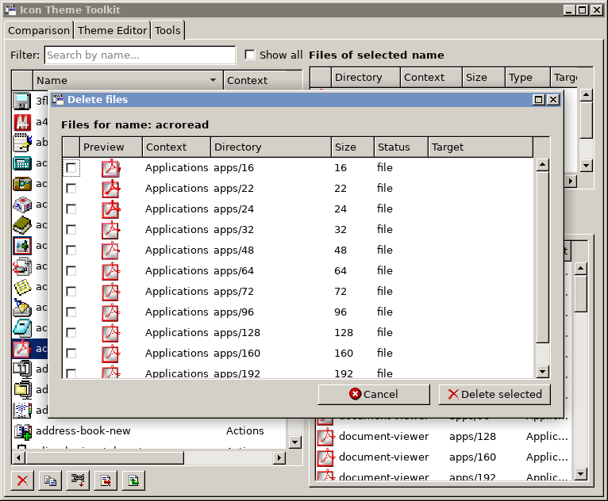

# icon-theme-toolkit_beta

## Description:
English version of [icon-theme-toolkit](https://github.com/nestoris/icon-theme-toolkit) for international beta-testers

The translation is performed by [this script](https://github.com/nestoris/icon-theme-toolkit/blob/main/translate.awk), and it might have missed something.

## How to use:
```
git clone https://github.com/nestoris/icon-theme-toolkit_beta.git
cd icon-theme-toolkit_beta
gjs icon-theme-toolkit.js
```
## Requirements:
`GJS, GTK3, icoutils`
## Screenshots:
Icon themes comparison tab:


index.theme editing tab:


Theme tools overal:


Selective removing tool:



ICO export tool:


ICO import tool:


Symlink matrix tool:

